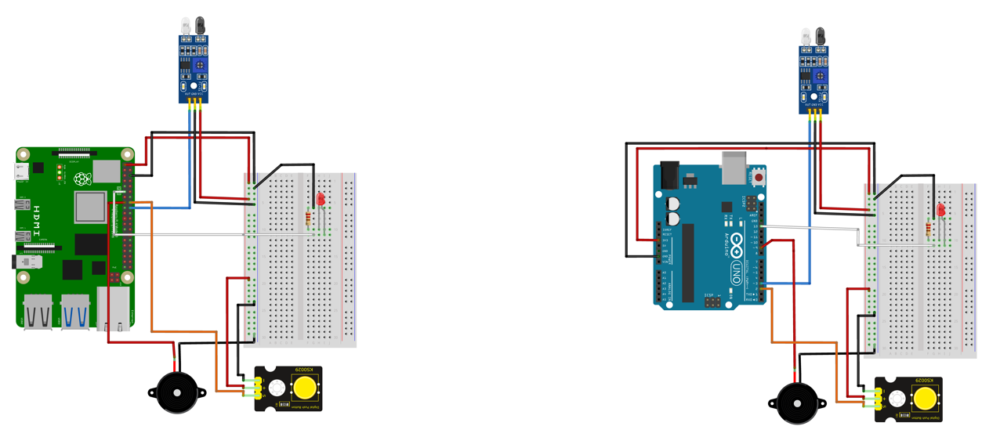

# Technical Report: Raspberry Pi Alarm System (Assembly Implementation)

## 1. Introduction
This report documents the implementation of an alarm system developed in ARM64 Assembly language (`alarm_inverted.S`) for the Raspberry Pi 4. The system interfaces with a Push Button, PIR Motion Sensor, LED, and Active Buzzer.

## 2. System Architecture

### 2.1 Hardware Interface
The program interacts with the hardware using **Memory Mapped GPIO**. Instead of using slow file-based sysfs calls, the program maps the Raspberry Pi's GPIO physical memory address range into its virtual memory space.

*   **Target Device**: `/dev/gpiomem` (Allows non-root GPIO access if permissions allow, though `sudo` is often used).
*   **Base Address**: `0xFE200000` (Raspberry Pi 4 BCM2711 peripheral base).
*   **Page Size**: 4KB (Standard system page size).

### 2.2 Pin Configuration
| Component | GPIO Pin | Register | Function Selection | Logic |
| :--- | :---: | :---: | :---: | :--- |
| **LED** | GPIO 17 | `GPFSEL1` | Output (001) | Active High |
| **Buzzer** | GPIO 22 | `GPFSEL2` | Output (001) | **PWM Modulated** |
| **Button** | GPIO 23 | `GPFSEL2` | Input (000) | **Active Low** |
| **Sensor** | GPIO 24 | `GPFSEL2` | Input (000) | **Active Low** |

## 3. Algorithm and Logic

### 3.1 Initialization Phase
1.  **File Open**: The program uses `openat` (syscall 56) to open `/dev/gpiomem`.
2.  **Memory Map**: It uses `mmap` (syscall 222) to map 4096 bytes at offset 0. This gives a pointer (saved in register `x19`) to the start of the GPIO registers.
3.  **Configuration**:
    *   **GPFSEL1**: Bits for GPIO 17 are cleared and set to `001` (Output).
    *   **GPFSEL2**: Bits for GPIO 22 are set to `001` (Output). Bits for GPIO 23 and 24 are cleared to `000` (Input).

### 3.2 Main Polling Loop
The system enters an infinite loop to monitor inputs.
*   **Register Read**: It reads the `GPLEV0` (GPIO Level 0) register, which contains the current state of pins 0-31.
*   **Bit Masking**: It uses the TST (Test) instruction to check bit 23 and bit 24.
*   **Active Low Logic**:
    *   Standard logic usually checks for HIGH (1).
    *   This implementation checks for **LOW (0)** using the `b.eq` (Branch if Equal to 0) instruction.
    *   This logic assumes the sensors pull the line to Ground (0V) when triggered.

### 3.3 Logic Inversion Rationale
During testing, it was observed that the "Standard" (Active High) logic caused the alarm to trigger continuously immediately upon running. This occurred because:
1.  **Floating Inputs**: The GPIO pins, when not actively driven to Ground, often float to a "High" state due to internal pull-up resistors or electrical interference.
2.  **Module Behavior**: Many sensor and button modules are designed as "Active Low". They output a High signal (VCC) when idle and pull the signal to Ground (Low) when triggered.

To correct this, the logic was **inverted** in `alarm_inverted.S`. Instead of waiting for the bit to become `1` (High), the program now waits for the bit to become `0` (Low), ensuring the alarm only triggers when the button is pressed or motion is detected.

### 3.3 Alarm Trigger & Volume Control
When a trigger is detected, the system executes an alarm sequence 5 times.

#### Software PWM (Pulse Width Modulation)
To reduce the buzzer volume without external resistors, the code implements a software-based PWM loop instead of a constant signal.

*   **Signal**: 100 Hz (approx).
*   **Period**: 10ms.
*   **Duty Cycle**: 10% (1ms ON, 9ms OFF).
*   **Implementation**:
    1.  Turn Buzzer **ON** (Write to `GPSET0`).
    2.  Sleep **1ms**.
    3.  Turn Buzzer **OFF** (Write to `GPCLR0`).
    4.  Sleep **9ms**.
    5.  Repeat 50 times (Total duration: 0.5 seconds).

This fast switching is audible as a continuous tone but with reduced effective energy (lower volume).

### 3.4 Timing
Timing is handled by the `nanosleep` syscall (101). Two `timespec` structures are defined in the data section:
*   `ts_pwm_on`: 1,000,000 ns (1ms)
*   `ts_pwm_off`: 9,000,000 ns (9ms)
*   `ts_500ms`: 500,000,000 ns (Silence phase)

## 4. Conclusion
The implementation demonstrates low-level hardware control using ARM64 assembly. By manually manipulating GPIO registers and implementing timing loops, the system achieves precise control over inputs and outputs. The addition of software PWM showcases the flexibility of assembly for signal modulation without dedicated hardware drivers.
